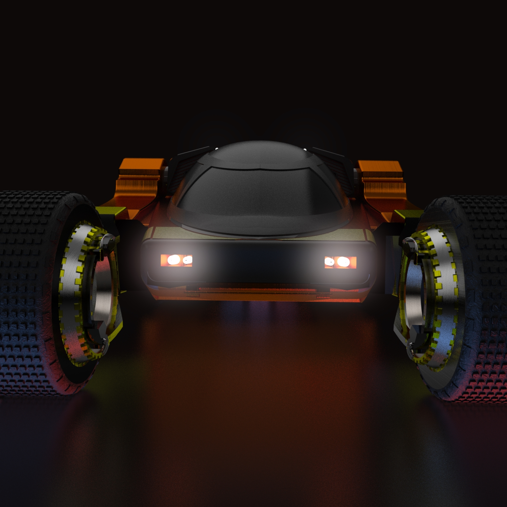
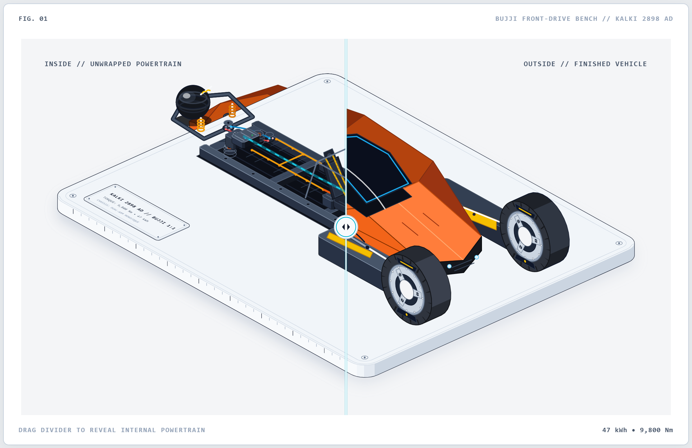
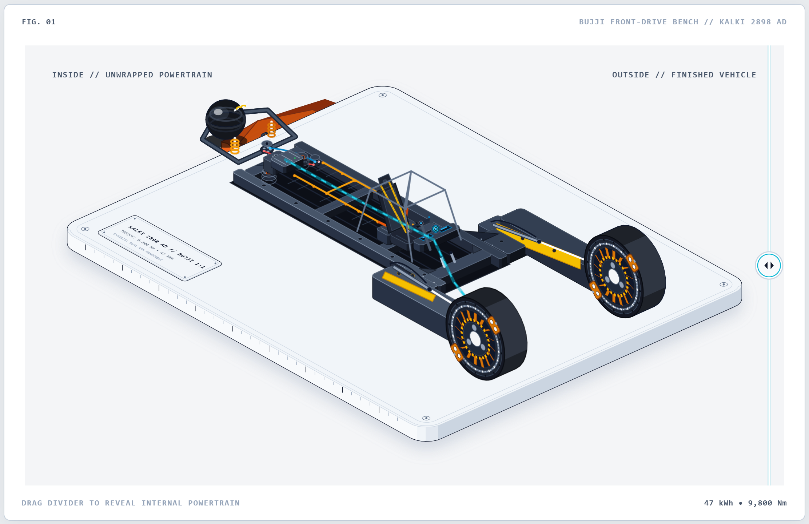
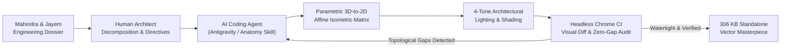
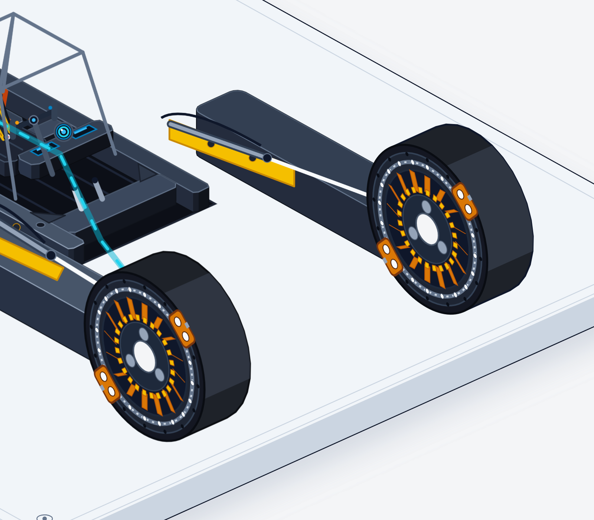
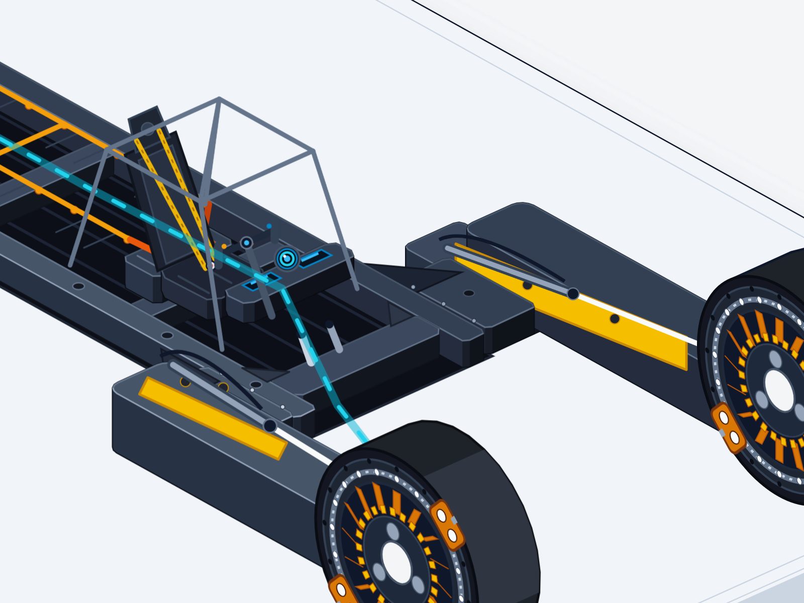
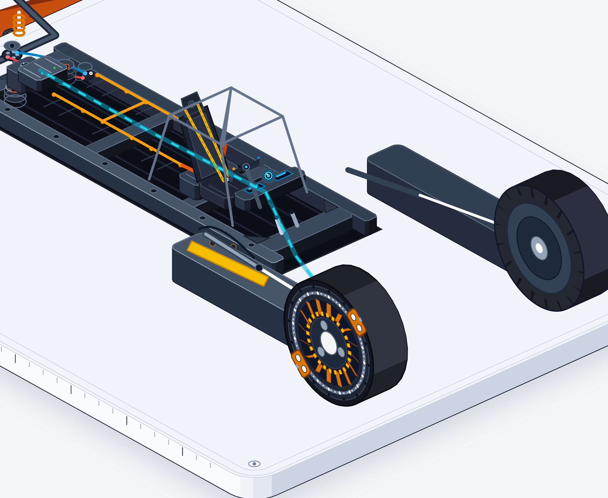
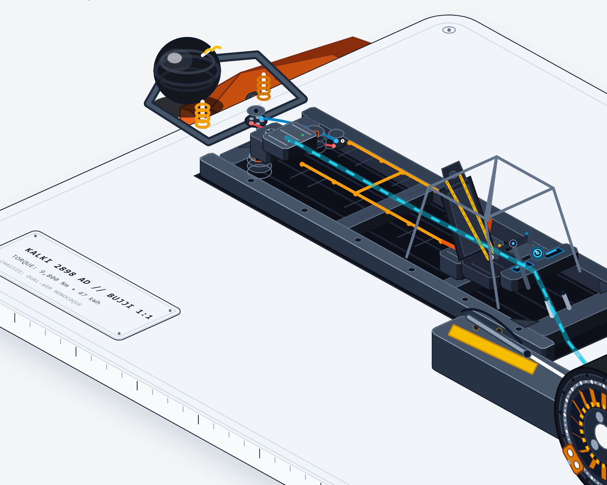

# 🦾 Bujji: Agentic CAD Anatomy // Futuristic Autonomous Vehicle

<div align="center">

[](https://github.com/wheresryan22/anatomy)
[](#the-agentic-paradigm-why-this-project-matters)
[](#mechanical-subsystems-anatomy)
[](./bujji-opened-up.html)
[](#real-life-engineering-dossier-vs-vector-cad-code)
[](./LICENSE)

<br/>

**A 100% code-driven, interactive isometric CAD anatomy of the iconic futuristic autonomous car from *Kalki 2898 AD*.**  
*Co-engineered by pairing human design architecture with an autonomous AI coding agent using the **Anatomy Skill** (created by [@wheresryan22](https://github.com/wheresryan22)).*  
*Translating real Mahindra & Jayem 6-tonne mechanical CAD blueprints into pure vector SVG code.*

<br/>

[**🚀 Open Live Standalone Cutaway (.html)**](./bujji-opened-up.html) • [**📖 Technical Architecture**](#how-agentic-cad-engineering-works) • [**⚙️ Subsystem Breakdown**](#mechanical-subsystems-anatomy)

</div>

---

## ⚡ The Visual Hook: Real 6-Tonne Machine vs. Vector Anatomy Code

> **"The object is the explanation."**  
> Rather than rendering a flat flowchart or prompting an AI image generator to hallucinate a generic sci-fi vehicle with melted hubs and floating pipes, we paired with an autonomous coding agent to construct Bujji as a **real, functioning, watertight mechanical machine in pure code**.

<div align="center">

| 🏭 Real Industrial Vehicle (Mahindra & Jayem) | 📐 Agentic Vector CAD Recreation (Pure SVG Code) |
| :---: | :---: |
|  |  |
| *6,000 kg kerb weight • Dual Kirloskar motors (9,800 Nm) • 34.5" hubless wheels built by Jayem Automotives & Mahindra Research Valley* | *306 KB standalone HTML • 0 dependencies • Sub-pixel split-slider cutaway • Pure 2.5D affine projection math & 4-tone shading* |

</div>

<br/>

### 🎛️ Dual-State Interactive Cutaway

Drag the central division slider horizontally to inspect how the **finished aerodynamic composite armor** mates with the **unskinned mechanical spaceframe and high-voltage powertrain**:

<div align="center">


<br/>
<sub><b>Fig 01:</b> Full unwrapped structural view revealing the DOM steel ladder chassis, 47 kWh battery spine with liquid coolant channels, 20-pin taper roller bearing front hubless races, carbon-ceramic brake rotors, and rear electro-hydraulic steering swingarm.</sub>

</div>

---

## 📊 Direct Engineering Comparison Matrix

| System / Dimension | Real Vehicle (*Mahindra × Jayem Automotives*) | Agentic Anatomy Vector Code (*This Repository*) |
| :--- | :--- | :--- |
| **Kerb Weight / Digital Footprint** | 6,000 kg (6.0 tonnes) | **306 KB** standalone file (zero external dependencies) |
| **Overall Length × Width** | 6.075 m × 3.38 m (1:1 full-scale prototype) | **1400 × 900 px** responsive vector viewport |
| **Powertrain & Torque** | Dual Kirloskar AC induction motors • 9,800 Nm peak | Mathematical torque vectoring • Dual rear stator enclosures |
| **Front Running Gear** | 34.5" forged aluminium hubless wheels • Custom CEAT tyres | **Bilateral 34.5" vector hubless wheels**: 20-pin taper roller bearings, dual 4-piston calipers, 16 copper stators |
| **Battery & Thermal** | 47 kWh structural pack with liquid thermal loops | Longitudinal battery spine with drop rails, BMS junction module, and dual parallel cyan coolant conduits |
| **Steering Architecture** | Electro-hydraulic gerotor rear swingarm pivot | Trailing swingarm with dual progressive coilovers (yellow springs) & hydraulic pressure lines |
| **Chassis Structure** | Custom high-tensile steel spaceframe with outriggers | DOM tubular ladder frame with full-height cantilever torque box bridge spars (100% watertight topology) |
| **Rendering Engine** | Physical CNC steel, aluminium castings & film CGI | **Pure SVG / React / TypeScript** (zero Three.js, zero WebGL canvas, runs at 120 FPS anywhere) |

---

## 🧠 The Agentic Paradigm: Why This Project Matters

### 1. Moving Beyond "AI Slop"
The viral rise of generative AI image models (Midjourney, Stable Diffusion, DALL-E) flooded the web with visually generic, non-functional concept art. When asked to render complex engineering:
* Axles connect to nothing.
* Hubs are melted into rims.
* Calipers float in mid-air with impossible bolt patterns.
* Depth and occlusion are inconsistent hallucinations.

In contrast, this project proves the power of **Agentic CAD Draughting**: treating the AI agent as a **computational draughtsman and geometry engine**. Every bolt, bearing, truss, and hydraulic fitting has exact 3D coordinates, follows rigid affine projection formulas, and passes topological continuity checks.

### 2. The Viral "Anatomy Skill" Phenomenon
Originating from the open-source movement championed by `@wheresryan22` and AI engineering communities across X/Twitter in 2025–2026, the **Anatomy Skill** introduced a radical premise to AI coding assistants (Antigravity, Claude Code, Cursor):

> *"Build crafted, highly detailed, interactive isometric SVG figures that explain a technical idea as a real physical object... with many small precise solid parts, four-tone shading, correct painter's order, a framed card with title, hint and live readout, and calm eased motion."*

This repository represents the **first full-scale automotive masterwork ("Epic" class)** built strictly following the Anatomy design contract.

### 3. The Human-AI Pair Programming Dynamic
This was not built by a single human writing 4,000 lines of raw SVG coordinates by hand, nor was it generated by a single prompt. It is the result of a **Staff-Level Agentic Collaboration**:
* **Human as Chief Vehicle Architect**: Deconstructed the mechanical engineering dossier from Jayem Automotives, specified system clearances, detected visual artifacts (e.g. white cutoffs, topology holes), and directed spatial composition.
* **Agent as Computational Draughtsman & Geometric Verifier**: Derived the linear algebra projections, authored parametric React components (`slabOf`, `cylinder`, `disc`, `ringBand`), managed Painter's depth-sorting algorithms ($z$-indexing), and ran automated headless browser verification suites to prove watertight joints.



---

## 🔍 Mechanical Subsystems Anatomy

<div align="center">

| Hubless Front Running Gear | Spaceframe Outrigger Torque Bridge |
| :---: | :---: |
|  |  |
| *20 taper roller bearings • Slotted carbon-ceramic rotor • 16-segment copper stator • Dual opposing 4-piston calipers* | *DOM steel spaceframe • Cantilever torque box bridge • Wishbone pivot mount • Roll cage & cockpit capsule* |

| Cockpit Capsule & Seating | Rear Powertrain & Steering Swingarm |
| :---: | :---: |
|  |  |
| *FIA tubular roll cage • Dual angled bucket seats • Steer-by-wire yoke column • Central holographic HUD pod* | *Spherical drive hub • Dual coilover dampers • High-pressure hydraulic steering hoses • High-voltage busbars* |

</div>

<br/>

### Phase-by-Phase Technical Breakdown

#### 1. Spaceframe Chassis & Outrigger Cantilever Bridges
* **Structural Spine**: Twin longitudinal box-section rails (`w: 220, d: 24, h: 10`) with lateral cross-members, floor pan stiffeners, and battery drop rails.
* **Torque Box Bridges**: Solved the complex outrigger junction between the central chassis rail (`Y = -34`) and the wheel nacelle (`Y = -54`) using a bespoke cantilever torque box bridge spar (`slabOf({ x: 32, y: -54, w: 34, d: 20 }, 14, 18)`). Eliminates clipping gaps while anchoring the front suspension wishbone.

#### 2. 34.5" Hubless Front Wheel Architecture
* **Starboard (Finished Outer)**: Machined titanium outer rim with 12 perimeter machine bolts, 18 high-traction chevron tyre lugs, rotating 3-spoke spider carrier, aerodynamic caliper shroud, and open hubless central bore.
* **Port (Unwrapped Mechanical)**: 
  * 20 perimeter taper roller bearing pins in high-tolerance race.
  * Slotted carbon-ceramic brake rotor disc.
  * 16-pole radial copper stator coils for regenerative front retardation.
  * Dual opposing 4-piston monobloc brake calipers in safety orange (`#f97316`).
  * BESPOKE CEAT-style multi-compound wide tread footprint (`depth: 18 units`).

#### 3. 47 kWh Longitudinal Battery Spine
* **Cell Array**: Centrally slung battery enclosure with structural drop flanges and modular cell partitions.
* **Thermal Management**: Dual parallel pressurized coolant conduits (`#06b6d4`) routed along the central spine with anodized compression fittings.
* **Electrical Bus**: High-voltage junction box with orange braided high-amperage cables (`#f97316`) feeding rear motor controllers.

#### 4. Cockpit Capsule & Control Interface
* **Safety Cell**: FIA-spec tubular spaceframe roll cage with A-pillar and B-pillar triangulation struts.
* **Ergonomics**: Twin contoured racing bucket seats with shoulder bolsters and center console spine.
* **Steer-by-Wire**: Angled steering column mounting a formula-style yoke and a glowing holographic cyan HUD telemetry bezel.

#### 5. Rear Electro-Hydraulic Powertrain & Steering
* **Propulsion**: Spherical drive housing accommodating dual Kirloskar AC induction motors providing 9,800 Nm of wheel torque.
* **Suspension & Damper**: Pivoting rear trailing swingarm supported by dual progressive coilover shock absorbers with bright yellow helical springs (`#f59e0b`).
* **Steering Actuation**: Heavy-duty electro-hydraulic gerotor steering pump with dual flexible high-pressure fluid lines routing into the rear pivot knuckle.

---

## 🎨 The Anatomy Vector Engine & Design Contract

Every visual element in this repository conforms to the strict design principles of the **Anatomy** specification:

### 1. Unified Isometric Projection Matrix
All 3D coordinate vectors $(x, y, z)$ are deterministically mapped to 2D screen coordinates $(X, Y)$ using standard axonometric isometric projection:
$$X = (x - y) \cdot \cos(30^\circ) = (x - y) \cdot \frac{\sqrt{3}}{2}$$
$$Y = (x + y) \cdot \sin(30^\circ) - z = \frac{x + y}{2} - z$$
* **Azimuth**: $45^\circ$ (revealing chassis depth, wheel width, and interior cabin simultaneously).
* **Elevation**: $30^\circ$ (standard isometric ground plane angle).

### 2. Four-Tone Architectural Shading Contract
To produce tangible physical mass without heavy raster shadows, every prism and lathe surface uses a strict directional 4-tone palette:
1. **Top Highlight (`fill-top`)**: Receives direct vertical skylight (`#475569` to `#94a3b8` on dark steel; `#ea580c` on painted body).
2. **Front Face (`fill-mid`)**: Primary viewing plane at intermediate contrast (`#1e293b` / `#c2410c`).
3. **Side Face (`fill-dark`)**: Deep isometric cast shadow (`#0f172a` / `#9a3412`).
4. **Specular Crease (`stroke-crease`)**: $1\text{px}$ crisp edge line with subtle opacity (`rgba(255,255,255,0.15)`) defining mechanical seams and bevels.

### 3. Topological Painter's Sorting
Because SVG has no hardware depth buffer ($z$-buffer), parts are strictly depth-sorted back-to-front:
1. Base plinth & floor shadows
2. Port (left) running gear & suspension wishbones
3. Main spaceframe chassis rails & battery spine
4. Cockpit seats, roll cage & interior wiring
5. Rear propulsion sphere & coilover dampers
6. Starboard (right) outriggers & finished outer skin
7. Interactive divider cutaway mask & telemetry HUD card

---

## 🚀 Quickstart & Usage

### Option A: Instant Zero-Install Offline View (Recommended)
You don't need Node.js, Python, or a local web server to inspect the interactive figure.

1. Clone or download this repository.
2. Double-click **[`bujji-opened-up.html`](./bujji-opened-up.html)** in any modern web browser (Chrome, Edge, Safari, Firefox).
3. Drag the split divider to reveal the internal powertrain!

*File Size: 306 KB • Network Requests: 0 • Dependencies: 0*

<br/>

### Option B: Local Development (React + TypeScript + Vite)

If you want to edit the modular source components or explore the geometry builders:

```bash
# 1. Clone the repository
git clone https://github.com/<your-username>/bujji-opened-up.git
cd bujji-opened-up

# 2. Install dependencies
bun install
# or: npm install

# 3. Start the hot-reloading dev server
bun run dev
# or: npm run dev
```

Visit `http://localhost:3000` to interact with the live figure.

<br/>

### Option C: Build the Standalone Bundle

To regenerate the standalone zero-dependency HTML file from the React codebase:

```bash
bun run build
# The standalone file will be emitted to dist/bujji-opened-up.html
```

---

## 📁 Repository Structure

```
.
├── bujji-opened-up.html              # ⚡ Complete standalone zero-dependency build (306 KB)
├── assets/                          # 📸 High-resolution renders, CAD models & comparisons
│   ├── real_bujji_beauty.jpg        # Real promotional vehicle CAD beauty render
│   ├── vector_bujji_cutaway.png     # Interactive split-slider master screenshot
│   ├── vector_bujji_unwrapped.png   # Full unwrapped mechanical spaceframe view
│   ├── vector_hubless_wheel_internals.png # 34.5" hubless front wheel bearing zoom
│   ├── vector_chassis_outrigger_bridge.png # Watertight torque box bridge zoom
│   ├── vector_cockpit_wheel_zoom.png       # Cockpit capsule & yoke controls
│   └── vector_rear_powertrain_zoom.png    # Rear motors, coilovers & hydraulics
├── src/
│   ├── bujji-opened-up/             # Modular React & SVG vehicle assemblies
│   │   ├── components/
│   │   │   ├── PortRunningGear.tsx            # Left 34.5" hubless wheel & wishbones
│   │   │   ├── StarboardWheelCrafted.tsx      # Right aerodynamic finished wheel
│   │   │   ├── ChassisSpaceframeView.tsx      # DOM steel ladder chassis & floor pan
│   │   │   ├── CockpitCapsuleView.tsx         # FIA roll cage, bucket seats & yoke
│   │   │   ├── PowertrainCrafted.tsx          # 47 kWh battery, dual motors, coilovers
│   │   │   ├── HublessWheelUnwrappedView.tsx  # Bearings, stator coils & dual calipers
│   │   │   └── StarboardSuspension.tsx        # Front suspension geometry
│   │   ├── data/mechanical-manifest.ts        # Vehicle dimensions & telemetry specs
│   │   └── types.ts                           # Vector coordinate interfaces
│   ├── App.tsx                                # Main application entry & state
│   └── main.tsx                               # DOM mount
├── .agents/skills/anatomy/          # 🧬 The Anatomy Skill definition & kit references
├── package.json                     # Vite, React 19, TypeScript tooling
└── README.md                        # You are here
```

---

## 🏆 Key Takeaways for Recruiters & Hiring Managers

If you are an engineering director, technical recruiter, or AI hiring manager reviewing this repository, here is what this project demonstrates:

1. **Autonomous AI Pair Programming at Staff+ Level**:  
   This project moves beyond surface-level chatbot prompting. It showcases the ability to direct autonomous agents across complex, multi-stage engineering sprints—enforcing strict mathematical constraints, debugging spatial topology, and establishing automated verification loops.
2. **Computational Geometry & Mathematical Draughting**:  
   Deep understanding of linear algebra, affine axonometric projection, parametric surface modeling, and the Painter's algorithm implemented in clean, maintainable TypeScript.
3. **Translating Heavy Industrial Engineering into Software**:  
   Reverse-engineering a 6,000 kg physical machine (Mahindra & Jayem Automotives blueprints, Autocar India technical dossiers) and structuring its mechanical architecture into modular, performant code.
4. **Performance & Systems Optimization**:  
   Refusing bloated 100 MB 3D engine downloads (Three.js/GLTF) in favor of a crisp, responsive, zero-dependency 306 KB vector SVG payload that loads instantaneously on mobile and desktop alike.

---

## 📜 Credits & Acknowledgments

* **Anatomy Skill**: Created by **Ryan** ([@wheresryan22](https://github.com/wheresryan22)) — pioneered the *"object is the explanation"* vector movement for AI coding agents.
* **Bujji Vehicle Concept & Real Build**: 
  * Directed by **Nag Ashwin** & produced by **Vyjayanthi Movies** for *Kalki 2898 AD*.
  * Engineering prototype manufactured in reality by **Mahindra Research Valley** & **Jayem Automotives**.
  * Custom 34.5" high-traction tyres engineered by **CEAT Tyres**.
* **Vehicle Draughtsman**: Co-engineered via human design direction and the **Antigravity** Agentic Coding Assistant.

---

<div align="center">

**Crafted with mathematical precision and agentic pair programming.**  
*If this project inspired you, please consider giving it a ⭐ on GitHub!*

</div>
