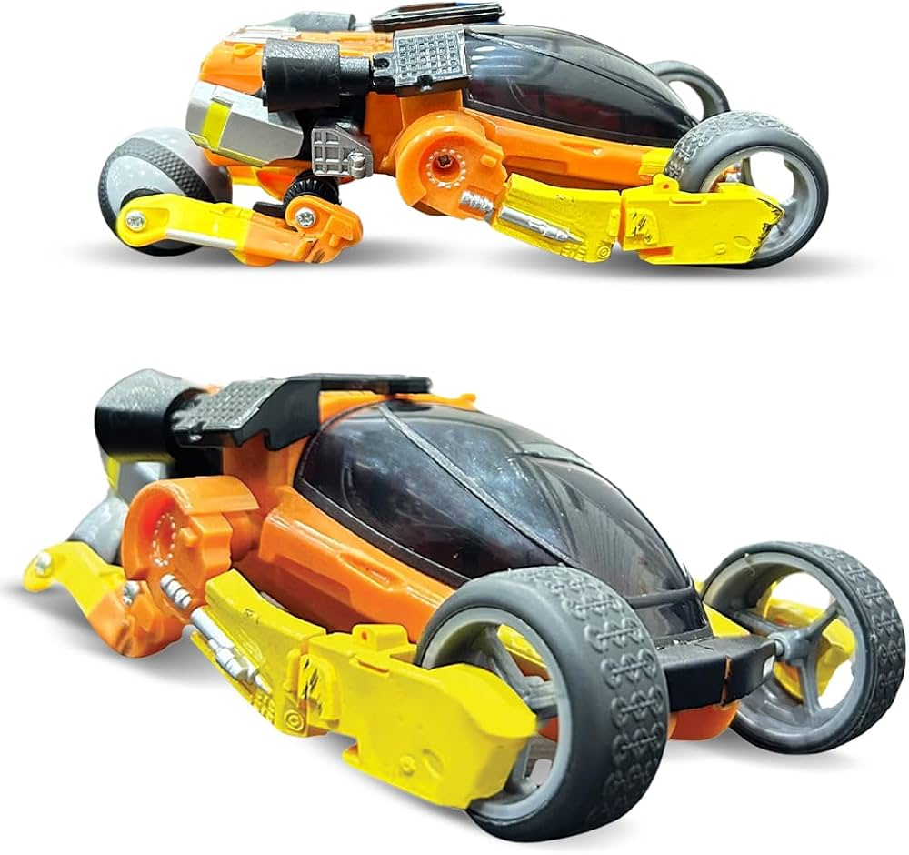

<h1 align="center">Bujji, opened up</h1>

<div align="center">

[](./bujji-opened-up.html)
[](#-how-it-works-stress-testing-the-anatomy-contract)
[](https://github.com/wheresryan22/anatomy)
[](./LICENSE)

<br/>

**Stress-testing the viral Anatomy Skill ([@wheresryan22](https://github.com/wheresryan22)) on a real 6-tonne machine.**  
*Translating Bujji from Kalki 2898 AD into an interactive, pure vector SVG cutaway — running inside a zero-dependency, 306 KB standalone HTML file.*

<br/>

[**⚡ Launch Standalone HTML**](./bujji-opened-up.html) &bull; [**📐 Subsystems**](#-mechanical-subsystems) &bull; [**⚙️ How It Works**](#-how-it-works-stress-testing-the-anatomy-contract) &bull; [**🚀 Quickstart**](#-quickstart)

</div>

---

<h2 align="center">Real Machine vs. Pure Vector Code</h2>

<div align="center">

| Traditional Diagrams & GenAI | The Anatomy Skill (*This Project*) |
| :--- | :--- |
| **Mermaid / Flowcharts**: Abstract boxes and arrows that can't explain physical mechanisms. | **The object IS the explanation**: A functioning, code-driven mechanical machine you can inspect and manipulate. |
| **Generative AI (Midjourney)**: Glossy concept art with melted axles, impossible bolt patterns, and zero code. | **Pure SVG Vector Geometry**: Every bearing, wishbone, and truss mapped to exact axonometric 3D coordinates. |

<br/>

| 🏭 Real Vehicle (*Mahindra × Jayem Automotives*) | 📐 Pure Vector SVG Recreation (*This Project*) |
| :---: | :---: |
|  |  |
| *6,000 kg kerb weight • 6.075 m length • Dual Kirloskar motors (9,800 Nm) • 34.5" hubless front wheels built by Jayem & Mahindra* | *306 KB single-file HTML • 0 external dependencies • 120 FPS responsive vector • True $42^\circ$ axonometric projection* |


</div>

<br/>

<h3 align="center">Interactive Split-Slider Cutaway</h3>

<div align="center">

Drag the central division line horizontally to peel between the **finished aerodynamic composite armor** and the **unskinned mechanical spaceframe**:

<br/>


<sub><b>Fig 01:</b> Full unwrapped structural view: DOM steel ladder chassis, 47 kWh battery spine with liquid coolant channels, 20-roller front hubless races, carbon-ceramic brake rotors, and rear electro-hydraulic steering swingarm.</sub>

</div>

---

<h2 align="center">Mechanical Subsystems</h2>

<div align="center">

| Hubless Front Running Gear & Bearings | Spaceframe Outrigger Torque Bridge |
| :---: | :---: |
|  |  |
| *20 taper roller bearings • Slotted carbon-ceramic rotor • 16-pole copper stator • Dual opposing 4-piston calipers* | *DOM steel spaceframe • Cantilever torque box bridge • Front wishbone pivot mount • Structural roll cage* |

| Pilot Cockpit Capsule & Controls | Rear Powertrain & Steering Swingarm |
| :---: | :---: |
|  |  |
| *FIA tubular roll cage • Contoured pilot bucket seat • Steer-by-wire yoke column • Central holographic HUD pod* | *Spherical drive hub • Dual progressive coilover dampers • High-pressure hydraulic lines • Dual induction motors* |

</div>

---

<h2 align="center">How It Works: Stress-Testing the Anatomy Contract</h2>

Most uses of the **Anatomy Skill** explain small mechanical components (locks, valves, pressure gauges). This project pushed the design contract to an entire multi-system automotive platform:

1. **True 2.5D Isometric Geometry**: All 3D coordinates $(x, y, z)$ map deterministically to screen coordinates $(X, Y)$ at **$42^\circ$ azimuth** and **$30^\circ$ elevation**. No Three.js, no WebGL, no heavy 3D assets.
2. **4-Tone Directional Shading**: Every solid part (`slabOf`, cylinders, discs) uses a strict directional palette — top highlight, front face, cast shadow, and specular crease line — producing tangible physical mass without raster blur.
3. **Topological Depth Sorting**: Without a hardware $z$-buffer, all 26 subsystem assemblies are sorted back-to-front using Painter's algorithm to maintain watertight visual joints.
4. **The Anatomy Technical Plate**: Structured inside the official Anatomy UI frame — with figure numbering, interactive hints, and a live telemetry readout card (`47 kWh • 9,800 Nm`) tied to a dynamic throttle regulator.

---

<h2 align="center">Quickstart</h2>

<div align="center">

### Option A: Instant Zero-Install View (Recommended)

Double-click **[`bujji-opened-up.html`](./bujji-opened-up.html)** in any modern web browser.  
*306 KB • 0 network requests • 0 dependencies • Runs offline.*

</div>

### Option B: Local Development (React + Vite)

```bash
# Clone repository
git clone https://github.com/<your-username>/bujji-opened-up.git
cd bujji-opened-up

# Install dependencies
npm install

# Start development server
npm run dev
```

Visit `http://localhost:3000` to interact with the hot-reloading dev server.

To regenerate the standalone single-file HTML bundle:
```bash
npm run bundle
```

---

<h2 align="center">Repository Structure</h2>

```text
.
├── bujji-opened-up.html     # ⚡ Complete standalone zero-dependency build (306 KB)
├── assets/                 # 📸 Curated renders & mechanical component zooms
│   └── cad_renders/        # High-res orthographic CAD projections
├── scripts/                # Python CAD extraction & standalone bundling scripts
├── src/                    # Modular React 19 & SVG vehicle assemblies
├── index.html              # Vite entrypoint
├── package.json            # Lean project dependencies
└── README.md
```

---

<h2 align="center">Credits & Open Skills Ecosystem</h2>

* **Anatomy Skill**: Created by **Ryan** ([@wheresryan22](https://github.com/wheresryan22)) — pioneering *"the object is the explanation"* vector movement for AI coding agents.
  ```bash
  # Install the Anatomy skill in Claude Code / Antigravity:
  npx skills add wheresryan22/anatomy
  ```
* **Bujji Original Vehicle**: Conceived by director **Nag Ashwin** & produced by **Vyjayanthi Movies** for *Kalki 2898 AD*.
* **Physical Engineering Prototype**: Built in reality by **Mahindra Research Valley** & **Jayem Automotives**, with custom 34.5" tyres by **CEAT**.

---

<div align="center">

Released under the [MIT License](./LICENSE).

</div>
